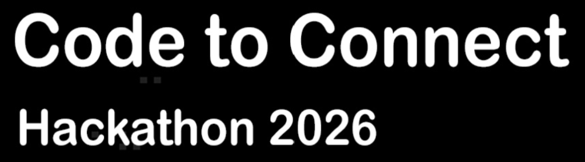
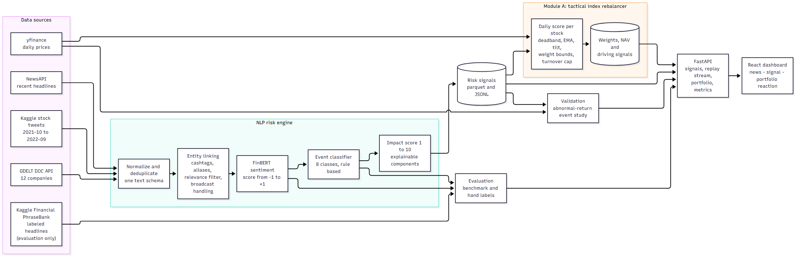

<div align="center">
  <a href="https://www.spglobal.com"></a>
  &nbsp;&nbsp;&nbsp;&nbsp;&nbsp;&nbsp;&nbsp;&nbsp;
  
</div>

# AI/NLP Risk Engine: From Financial News to Portfolio Signals

**Submission for the S&P Global and CRISIL Campus Hackathon 2026 (Final Round)**

| Parameter | Submission Details |
|---|---|
| **Candidate Name** | **Mridul Rajgaria** |
| **College / Campus** | **Vellore Institute of Technology, Bhopal** |
| **College Email ID** | `iammridul222@gmail.com` |
| **Demo Video Link** | [ADD YOUTUBE UNLISTED LINK] |
| **Slide Deck Link** | [**docs/presentation.pdf**](docs/presentation.pdf) |
| **Downstream Application** | **Module A: Tactical Index Rebalancer** (14 Large-Cap US Equities) |
| **Execution Mode** | 100% Offline Reproducible (Deterministic committed data, zero API keys needed) |

---

## 1. Project Overview, Problem Statement and Approach

### Problem
Markets react to news within minutes, but nobody can read everything. The case study asks for an **AI/NLP Risk Engine** that reads unstructured text (news and social media) and turns it into structured, machine-readable risk signals, plus at least one downstream application that uses them.

### What this project does
For every relevant headline or tweet, the engine outputs:

| Field | Meaning |
|---|---|
| **Sentiment score** | Tone of the text, from -1.0 (negative) to +1.0 (positive), from FinBERT |
| **Event class** | One of 8 classes: Geopolitical, Macroeconomic, Credit Event, Merger/Acquisition, Product Launch, Regulatory, Earnings, Other |
| **Impact score** | Estimated severity from 1 to 10, built from named components so every score can be explained |

The signals are served through a **FastAPI** service (with a replay stream) and can also be exported to files.

On top of the engine I built **Module A: a tactical index rebalancer**. It keeps a mock index of 14 large-cap US stocks and raises or lowers each stock's weight when signals arrive. A dashboard replays one year of history and shows, for any day:

> **News arrived -> the AI read it as a signal -> the portfolio weight changed -> performance followed**

### Scope, stated plainly
- **Built:** the full engine, the API and file export, Module A with a backtest, a validation study, and a React dashboard.
- **Not built:** Module B (the stress-testing tool). The case study asks for at least one downstream module, so I put the time into doing one thoroughly and measuring it honestly.

### Approach in four ideas
1. **Explainable by design.** The impact score is a weighted sum of four named components (event severity, sentiment strength, source credibility, mention volume), all configurable in `config/engine.yaml`. Click any signal on the dashboard to see the arithmetic.
2. **Measured, not assumed.** FinBERT scored 88.9% on a public benchmark but only 61.1% on 180 texts I labeled myself. Both numbers are reported (section 5).
3. **Validated against prices.** The impact score was tested against real abnormal stock returns with confidence intervals, a placebo test and confound controls.
4. **Reproducible offline.** The repository contains small deterministic samples of every dataset, so the dashboard and the API run with no downloads, no API keys and no model.

---

## 2. Architecture and Tech Stack

<div align="center">
  
</div>

*(Vector version: [docs/architecture.svg](docs/architecture.svg) | Source code: [docs/architecture.mmd](docs/architecture.mmd))*

### Pipeline
1. **Ingest and normalize** tweets, NewsAPI articles and GDELT headlines into one schema, removing duplicates, template spam and calendar or table tweets.
2. **Entity linking** maps each text to tickers using cashtags, company names, aliases and context words, filters irrelevant news, and splits weight across tickers for multi-ticker tweets ("broadcast" tweets).
3. **Sentiment** with FinBERT (`ProsusAI/finbert`, CPU) and a persistent cache.
4. **Event classification** with a rule-based classifier that returns the class, a confidence and the matched triggers.
5. **Impact scoring** and signal emission, one signal per (text, ticker).
6. **Module A** turns daily signals into index weights; the **validation** study compares signals with price moves.
7. **API and dashboard** serve and visualize everything.

### Tech stack

| Layer | Tools |
|---|---|
| Language and data | Python 3.11, pandas, pyarrow (Parquet), pydantic, PyYAML |
| NLP | FinBERT via Hugging Face `transformers`, PyTorch (CPU), rule-based event classifier |
| Validation and evaluation | scikit-learn, SciPy, matplotlib |
| API | FastAPI, Uvicorn, Server-Sent Events for replay |
| Frontend | React 18, TypeScript, Vite, Tailwind CSS, Apache ECharts, Vitest (fonts and charts are bundled, no CDN) |
| Quality | pytest backend suite (164 tests at the time of writing), 10 frontend tests, deterministic seeds, no look-ahead tests |
| Packaging | Docker, docker compose |

### Repository layout
```
config/            engine.yaml, rebalancer.yaml, companies.yaml, default.yaml (all parameters)
data/sample/       small committed samples so the project runs offline
docs/              evaluation, validation and Module A reports, diagrams, API doc
frontend/          React source (src/) and the prebuilt bundle (dist/)
src/ingestion/     fetchers and normalization
src/nlp/           entity linking, sentiment, event classifier, evaluation scripts
src/engine/        impact scorer, signal generation, validation, API, server
src/modules/       Module A: rebalancer and backtest
tests/             pytest suite
```

---

## 3. Dataset Used

All data is public or free-tier. No proprietary data is used. Full notes and cleaning counts are in [docs/data_notes.md](docs/data_notes.md).

| Source | Used for | Period | After cleaning |
|---|---|---|---|
| Kaggle *Stock Tweets for Sentiment Analysis and Prediction* (CC0) | Main text source and the backtest history | 2021-09-30 to 2022-09-29 | 80,793 raw -> 49,960 tweets for the 14 stocks |
| NewsAPI (free tier) | Live-style news feed | 2026-09 to 2026-10 | 1,863 raw -> 994 articles |
| GDELT DOC 2.0 API | Second news source | about 3 months to 2026-10 | 12 of 22 company queries succeeded -> 1,864 headlines |
| Kaggle *Sentiment Analysis for Financial News* (FinancialPhraseBank based) | Evaluating FinBERT only | no dates | 4,846 -> 4,838 headlines |
| Yahoo Finance via `yfinance` | Prices for validation and the backtest | from 2021-01-01 | 14 stocks plus 7 news-only names plus SPY |
| My own hand labels | Independent evaluation of sentiment and events | sampled from the above | 180 texts |

**Universe:** TSLA, AAPL, MSFT, AMZN, META, GOOGL, NFLX, AMD, PG, KO, DIS, BA, COST, PYPL (index). NVDA, JPM, BAC, GS, XOM, JNJ, WMT are tracked as news-only names with no index weight.

### Data quality findings (and what I did about them)
- **Duplicated tweets under several tickers.** 6,325 tweets appeared under more than one ticker label, and the MSFT and PG scrape pools were identical to AMZN's. I deduplicated across labels, so **MSFT and PG have almost no tweet signal** and mostly stay at base weight.
- **The scrape label is not the subject.** About a quarter of tweets mention a different ticker than their label, and 5.6% mention three or more tickers. Attribution uses cashtags and names, and broadcast tweets only emit a signal when they carry a clear event.
- **GDELT** was unreachable from my home network and rate-limited through a mobile hotspot, so only 12 of 22 company queries returned data.
- **The tweet history is one year (2021-22)** and TSLA makes up about 70% of it, so the committed sample caps each ticker at 3,000 tweets spread across months.
- **Salad Money and the Kaggle transactions dataset were not used**, because Module B was not built.

---

## 4. Quickstart and Installation

**Tested on:** Windows 11, Python 3.11.9 ([ADD DOCKER VERSION IF TESTED]). Node 24 is only needed to rebuild the frontend. The prebuilt frontend is committed, so **running the project needs no Node, no API keys and no model download.**

### Option A: Docker
```bash
git clone https://github.com/mridulrajgaria/Vellore-Institute-Of-Technology-Bhopal---Mridul-Rajgaria---hackathon.git
cd Vellore-Institute-Of-Technology-Bhopal---Mridul-Rajgaria---hackathon
docker compose up --build
```
Open http://127.0.0.1:8000/ .

### Option B: Python (Windows PowerShell)
```powershell
git clone https://github.com/mridulrajgaria/Vellore-Institute-Of-Technology-Bhopal---Mridul-Rajgaria---hackathon.git
cd Vellore-Institute-Of-Technology-Bhopal---Mridul-Rajgaria---hackathon
python -m venv .venv
.venv\Scripts\Activate.ps1
pip install -r requirements-runtime.txt
python -m src.engine.serve
```
Open http://127.0.0.1:8000/ .

### Option B: Python (macOS or Linux)
```bash
python3.11 -m venv .venv
source .venv/bin/activate
pip install -r requirements-runtime.txt
python -m src.engine.serve
```

If port 8000 is busy: `python -m src.engine.serve --port 8001`.

### Using the dashboard
1. Pick a day with the slider, or use the **Biggest days** chips. Space plays and pauses; the arrow keys step.
2. Read the **day summary** (what changed most and why).
3. Follow the three columns: **1 News** (what people were saying) -> **2 Signal** (what the AI understood, with "Show the math") -> **3 Portfolio** (what the portfolio did).
4. The **Methodology** page shows every accuracy and validation number, read from the same files as the docs.

A good day to start with is **2021-10-08**: JPMorgan raised the $DIS price target, the AI classified it as an Earnings-type analyst action with positive sentiment, and DIS rose from 6.98% to 9.92% of the portfolio.

### API
Interactive docs at http://127.0.0.1:8000/docs, reference in [docs/api.md](docs/api.md).
```bash
curl "http://127.0.0.1:8000/health"
curl "http://127.0.0.1:8000/signals?ticker=DIS&min_impact=6&limit=5"
curl "http://127.0.0.1:8000/portfolio/snapshot?date=2021-10-08"
curl "http://127.0.0.1:8000/meta/metrics"
```
Signals can also be written to a file: `python -m src.engine.export --format jsonl --out signals.jsonl`.

### Tests
```powershell
pip install -r requirements.txt
pytest -q
```
Frontend tests (optional, needs Node): `cd frontend && npm ci && npm test`.

### Re-running the full pipeline (optional)
This needs the full `requirements.txt` (PyTorch CPU and FinBERT, about 440 MB download), the raw Kaggle files in `data/raw/` (see [docs/data_notes.md](docs/data_notes.md)) and, for NewsAPI, a key in `.env` (copy `.env.example`).
```powershell
python -m src.ingestion.fetch_prices
python -m src.ingestion.fetch_newsapi
python -m src.ingestion.fetch_gdelt
python -m src.ingestion.normalize
python -m src.nlp.run_sentiment
python -m src.engine.run_signals
python -m src.nlp.eval_sentiment
python -m src.nlp.eval_hand_labels
python -m src.nlp.eval_events
python -m src.engine.validate
python -m src.modules.backtest
```
To rebuild the frontend: `cd frontend && npm ci && npm run build`.

---

## 5. Key Results and Domain Impact

All numbers below come from the committed reports: [sentiment_eval.md](docs/sentiment_eval.md), [sentiment_hand_eval.md](docs/sentiment_hand_eval.md), [event_eval.md](docs/event_eval.md), [validation.md](docs/validation.md) and [module_a.md](docs/module_a.md).

### 5.1 How accurate is the AI?

| Test | Result |
|---|---|
| FinBERT on the public FinancialPhraseBank benchmark (4,838 headlines) | **88.9% accuracy**, macro-F1 0.88 (majority class 59.4%, VADER 54.3%) |
| FinBERT on **my own 180 hand-labeled texts** | **61.1% accuracy**, macro-F1 0.60 |
| ...by source | GDELT headlines 74.0%, NewsAPI 61.4%, tweets 53.5% |
| ...by class | negative: precision 0.85, recall 0.71; **positive: recall only 0.30** |
| Event classifier on the same 180 texts | macro-F1 0.69; precise when it fires (Credit Event, Regulatory and Earnings precision 1.0) but **misses many events** (Earnings recall 0.23) |

FinBERT was fine-tuned on FinancialPhraseBank, so the 88.9% is optimistic. The 61.1% on social text and 2026 news is the more honest number. The AI is better at spotting bad news than good news, which suits a risk tool but affects how Module A treats positive signals.

### 5.2 Do the signals mean anything?
Event study on **2,072 ticker-days of tweets (2021-22)**, with block-bootstrap confidence intervals:
- Higher impact scores go with bigger abnormal price moves: Spearman rho = 0.159 (95% CI 0.122 to 0.194, p about 3e-13). Mean absolute abnormal return rises across quintiles **1.21% -> 1.35% -> 1.46% -> 1.71% -> 2.36%**; top minus bottom quintile **+1.15%** (CI +0.81% to +1.57%).
- It survives controls: partial correlation with recent volatility 0.116, 0.096 without TSLA, and a within-ticker shuffle placebo gives p = 0.001.
- Negative sentiment came before a **-1.11%** 3-day abnormal return (n = 338); positive sentiment before +0.08% (n = 394).
- **Caveats:** a tweet written after a move partly describes it, so same-day associations are not proof of prediction. The next-day figures are in [validation.md](docs/validation.md). The 2026 news window (240 ticker-days) shows **no detectable relationship** (rho = 0.014, p = 0.83); the sample is too small to conclude anything.

### 5.3 Module A: did the portfolio beat equal weight?
**No.** One year (Oct 2021 to Sep 2022), 14 stocks, 5 bps costs:

| Portfolio | Cumulative return | Sharpe (rf = 0) | Max drawdown |
|---|---|---|---|
| Sentiment strategy | -28.91% | -0.92 | -37.95% |
| Equal weight, rebalanced daily | -28.53% | -0.91 | -37.39% |
| Equal weight, buy and hold | -27.38% | -0.93 | -35.56% |
| SPY | -15.51% | -0.71 | -24.37% |

A within-ticker placebo puts the real Sharpe at the **48.5th percentile**, so there is **no detectable outperformance** in this window. The sensitivity grid is flat (every cell between -28.6% and -29.2%), and excluding TSLA's tilt changes little (-28.65%). The high-confidence-only variant did worse (-38.76%), likely because it trades on fewer, more concentrated signals. Parameters were fixed before testing (`config/rebalancer.yaml`: tilt 1.5, EMA half-life 2 days, +/-0.20 deadband, 1.25x weight on negative text, weights within 0.5x to 2x, 10% turnover cap) and were not tuned on these results.

### 5.4 Limitations
- One year of tweets in one market regime (a 2022 tech downturn); no out-of-sample period for the backtest.
- FinBERT is weak on tweets (53.5%) and misreads sentences about numbers versus expectations; positive recall is low.
- The hand-labeled set is small (180) and labeled by one person; rare event classes have very few examples (for example, 2 Credit Event).
- Credit Event is rare in stock chatter (8 emitted signals); the class exists to cover the case study's taxonomy.
- Sentiment measures the tone of a text, not its stance towards a specific stock.
- Module B was not built.

### 5.5 Domain impact
A risk or portfolio team can use the engine's output as **structured, explainable inputs**: a signed sentiment, an event class and a 1 to 10 severity for each company, with the reasoning attached. The validation shows the severity score is informative about the *size* of price reactions, which is what a risk screen needs, and the evaluation shows where the AI is trustworthy (negative news, curated headlines) and where it is not (tweets, positive news). The same signal feed could drive a stress-testing module (the case study's Module B) without changing the engine.

### 5.6 How this was built
I designed the architecture, the scoring formulas, the parameters and the evaluation plan, hand-labeled the evaluation set, and reviewed every result. An AI coding assistant wrote much of the code under my direction, in small commits visible in the history. Every number shown on the dashboard is read from the backend files, and automated tests check that the Methodology page matches the source reports.

### Licenses and attributions
- **Code:** MIT ([LICENSE](LICENSE)).
- **Tweets dataset:** *Stock Tweets for Sentiment Analysis and Prediction* (Kaggle, Hanna Yukhymenko), CC0 Public Domain.
- **Financial news benchmark:** *Sentiment Analysis for Financial News* (Kaggle, Ankur Sinha), derived from the FinancialPhraseBank (Malo et al., 2014), licensed under [CC BY-NC-SA 4.0](https://creativecommons.org/licenses/by-nc-sa/4.0/). It is used here only for non-commercial evaluation of the sentiment model. `data/sample/news_labeled_eval_sample.parquet` is a 500-row stratified sample of that dataset (deduplicated and cleaned; changes made) and **remains under CC BY-NC-SA 4.0**. It is not covered by the MIT license.
- **NewsAPI and GDELT:** used under their free-tier terms for development and evaluation. The repository stores only small samples of titles and descriptions.
